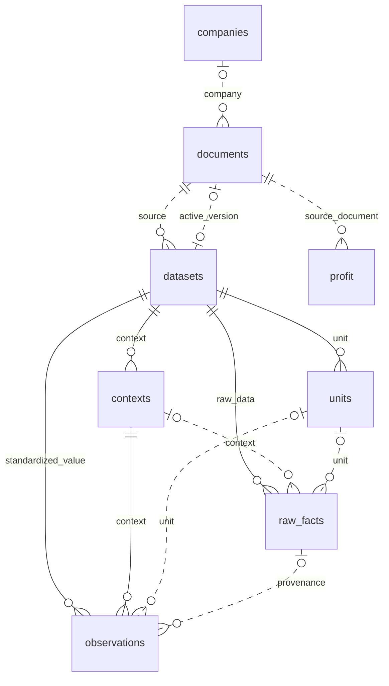

# データ処理とテーブル関係

金融庁EDINETの提出書類に付随するCSV・XBRLを元のETLで取り込み、出典情報、変換版、元行、標準値をPostgreSQLに保存します。公開SQLは書類の採用版から標準値を抽出し、円単位の `profit` に格納します。表示用と指標用のビューが `profit` を参照します。可視化には分析結果を使用する想定です。

## 物理的な外部キー

下図は分析に関わる外部キーの抜粋です。親側から子側への参照関係を示し、参照列の詳細は[テーブル定義](table-definitions.md)に記載します。

## 抽出とビューの論理的な関連

- SQL内の年度・書類管理番号の対応は登録時の指定です。年度から採用書類を自動選択するDB制約はありません。
- `profit.security_code` と `companies.security_code` は論理的に対応します。`profit` から `companies` への外部キーはありません。
- `profit_million_yen` と `profit_growth_rates` は `profit` に依存します。`profit_indicators` は `profit` の比率と `profit_growth_rates` の売上成長率を証券コード・年度で結合します。いずれもビューの依存関係です。
